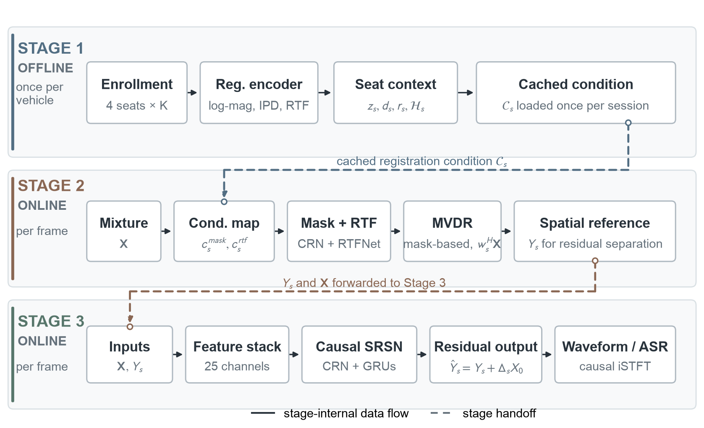

# SPR-SepNet Inference Package

Code-only release for:

**Enrollment-Only Adaptation for In-Car Multi-Seat Speech Separation via Seat Acoustic Registration**

No audio files and no checkpoint weights are included.


## 中文简介

SPR-SepNet 面向车内多座位目标语音分离。系统只需在新车型上采集一组短时的多位置座位注册音频，将其编码为车辆级 registration condition 并缓存；在线阶段直接复用该条件，不重新训练分离器，也不在每帧重新编码注册音频。

## 创新点

1. **仅注册适配**：将新车型适配转化为一次性座位声学注册，解耦车辆适配与在线分离。
2. **多位置座位注册表示**：联合 seat profile、方向与座位关系 embedding，以及 RTF 候选库，形成可缓存的车辆级条件。
3. **注册条件化空间前端**：registration 同时约束 mask 估计、RTF 修正和 MVDR 空间滤波。
4. **空间参考残差分离**：在 MSFE 输出基础上，用因果 SRSN-Z 做有界复数残差修正；新车型无需重训主分离器。
5. **跨车型与真实车验证**：在多车型分组互斥仿真、错车/错座、长时流式和两辆真实车上验证注册—分离—ASR 链路。

## 总体框架（论文 Fig. 1）



## 主实验结果（论文 Table 2）

| Method | Unseen SI-SDR (dB) | Held-out SI-SDR (dB) | Unseen PESQ | Held-out PESQ | Unseen STOI | Held-out STOI |
|---|---:|---:|---:|---:|---:|---:|
| Raw reference | 0.900 | 0.889 | 1.211 | 1.209 | 0.615 | 0.615 |
| Mask branch | 3.347 | 3.248 | 1.296 | 1.291 | 0.653 | 0.651 |
| MSFE | 4.241 | 4.156 | 1.405 | 1.404 | 0.674 | 0.673 |
| Compact residual baseline | 5.450 | 5.351 | 1.573 | 1.569 | 0.704 | 0.703 |
| SRSN-P | 6.357 | **6.288** | **1.759** | **1.754** | **0.729** | **0.727** |
| SRSN-Z | **6.366** | 6.256 | 1.756 | 1.753 | 0.726 | 0.724 |

## Included methods

- SPR-SepNet main chain: MSFE + SRSN-Z
- Adapted Conv-TasNet-IC: seat-identifier and registration variants
- Adapted So-DAS: GT-DOA and RegPhase variants

The internal SPR-SepNet methods are causal and support streaming inference.
Conv-TasNet-IC and So-DAS are adapted with non-causal configurations and are
evaluated offline on complete 3-s chunks.

## Directory layout

```text
inference/
  run_main.py       # MSFE + SRSN-Z
  run_ic.py         # adapted Conv-TasNet-IC
  run_sodas.py      # adapted So-DAS
  common.py
src/
  main_model/       # SPR-SepNet model definitions
  ic_convtasnet/    # IC Conv-TasNet adapter
  sodas/            # adapted So-DAS model code
  baselines/        # minimal upstream IC Conv-TasNet dependencies
checkpoints/        # place released weights here; not included
demo_data/          # place the demo recording here; not included
```

See `checkpoints/README.md` and `demo_data/README.md` for the expected file
names and input layout.

## Installation

```bash
python -m venv .venv
source .venv/bin/activate
pip install -r requirements.txt
```

## Run the main model

```bash
python inference/run_main.py \
  --demo demo_data/nissan_qashqai/set1_main_mix_interf2 \
  --teacher checkpoints/teacher_msfe.pt \
  --srsn checkpoints/srsn_z.pt \
  --out-dir outputs/main
```

Outputs:

```text
outputs/main/<scene>_msfe.wav
outputs/main/<scene>_mask.wav
outputs/main/<scene>_srsn_z.wav
```

## Run Conv-TasNet-IC

Registration-conditioned residual version:

```bash
python inference/run_ic.py \
  --demo demo_data/nissan_qashqai/set1_main_mix_interf2 \
  --teacher checkpoints/teacher_msfe.pt \
  --checkpoint checkpoints/ic_convtasnet_registration.pt \
  --variant registration \
  --out outputs/ic_registration.wav
```

Seat-identifier version:

```bash
python inference/run_ic.py \
  --demo demo_data/nissan_qashqai/set1_main_mix_interf2 \
  --checkpoint checkpoints/ic_convtasnet_seat_id.pt \
  --variant seat_id \
  --out outputs/ic_seat_id.wav
```

## Run So-DAS

Registration-phase version:

```bash
python inference/run_sodas.py \
  --demo demo_data/nissan_qashqai/set1_main_mix_interf2 \
  --teacher checkpoints/teacher_msfe.pt \
  --checkpoint checkpoints/sodas_reg_phase.pt \
  --condition reg_phase \
  --out outputs/sodas_reg_phase.wav
```

GT-DOA version requires a JSON file containing `[x, y]` direction values:

```bash
python inference/run_sodas.py \
  --demo demo_data/nissan_qashqai/set1_main_mix_interf2 \
  --checkpoint checkpoints/sodas_gt_doa.pt \
  --condition gt_doa \
  --doa path/to/doa.json \
  --out outputs/sodas_gt_doa.wav
```

## Input contract

- Sample rate: 16 kHz
- 8 channels per recording
- Enrollment: 4 seats x 5 clips x 3 s
- Target seat in demo metadata: seat 1 (driver)
- Interfering seat in demo metadata: seat 2 (front passenger)

See `THIRD_PARTY_NOTICES.md` before publishing adapted third-party code.
